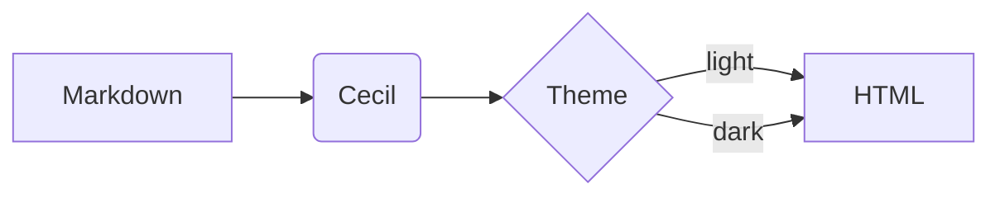
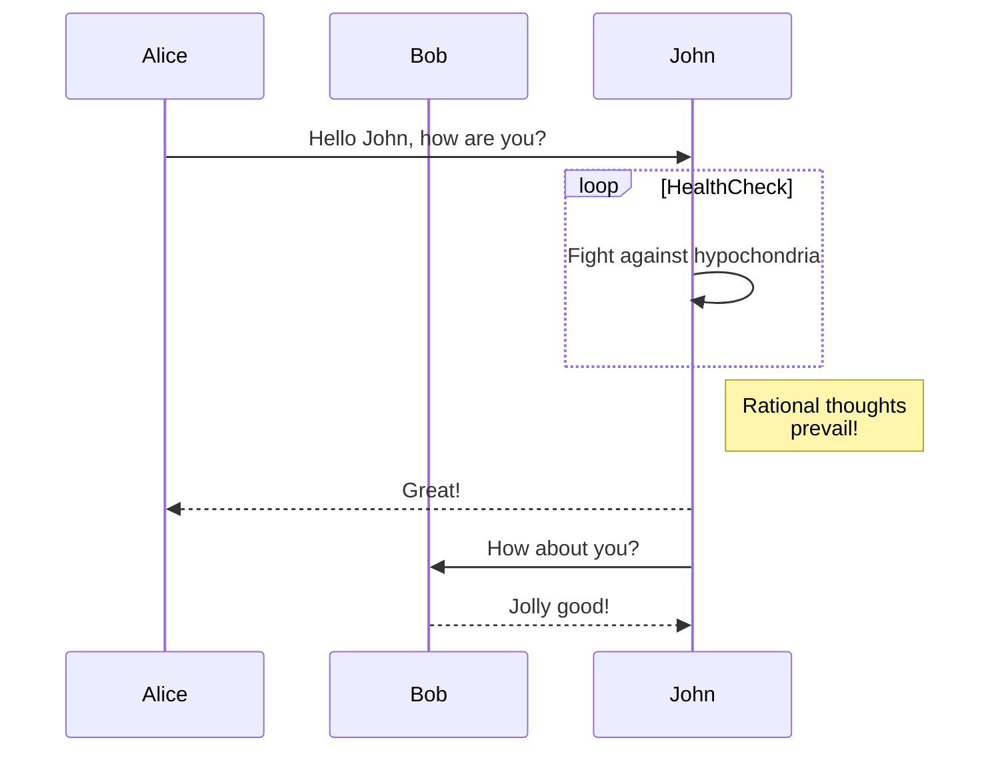
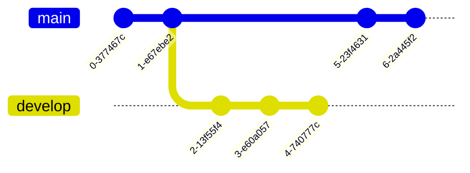

# Authoring content in Markdown

Cecil supports [Markdown](https://cecil.app/documentation/content/#markdown) syntax in `.md` files as well as [front matter](https://cecil.app/documentation/content/#front-matter) to define variables.

## Inline style

Text can be **bold**, _italic_, or ~~strikethrough~~.

```markdown
Text can be **bold**, _italic_, or ~~strikethrough~~.
```

You can [link to a page](/about.md) or [to another page](page:index).

```markdown
You can [link to a page](/about.md) or [to another page](page:index).
```

You can highlight `inline code` with backticks.

```markdown
You can highlight `inline code` with backticks.
```

## How to structure page

Cecil automatically use the page file name as title, but you can also define title and other variables in the [front matter](https://cecil.app/documentation/content/#front-matter).

You can structure content using a heading. Headings in Markdown are indicated by a number of `#` at the start of the line.

```yaml
---
title: Page title
description: Page short description.
---

Lorem ipsum dolor sit amet, consectetur adipiscing elit, sed do eiusmod tempor incididunt ut labore.

## Heading

Lorem ipsum dolor sit amet, consectetur adipiscing elit, sed do eiusmod tempor incididunt ut labore.
```

## Image

Images use Cecil’s built-in optimized asset support.


```markdown

```

Cecil search images in `assets/` and `static/` folders, but relative path is also supported:

```markdown

```

## List

* Unordered list
* Unordered list
* Unordered list

1. Ordered list
2. Ordered list
3. Ordered list

* Level 1
  * Level 2
  * Level 2
    * Level 3
    * Level 3

```markdown
* Unordered list
* Unordered list
* Unordered list

1. Ordered list
2. Ordered list
3. Ordered list

* Level 1
  * Level 2
  * Level 2
    * Level 3
    * Level 3
```

## Blockquote

> This is a blockquote, which is commonly used when quoting another person or document.
>
> Blockquotes are indicated by a `>` at the start of each line.

```markdown
> This is a blockquote, which is commonly used when quoting another person or document.
>
> Blockquotes are indicated by a `>` at the start of each line.
```

## Code block

A code block is indicated by a block with three backticks ` ``` ` at the start and end. You can indicate the programming language being used after the opening backticks.

```php
// PHP code
$config = [
    'title'   => "My website",
    'baseurl' => 'http://localhost:8000/',
];

Builder::create($config)->build();
```

<pre>
```php
// PHP code
$config = [
    'title'   => "My website",
    'baseurl' => 'http://localhost:8000/',
];

Builder::create($config)->build();
```
</pre>

## Horizontal rule below

---

```markdown
---
```

## Definition list

First Term
: This is the definition of the first term.

Second Term
: This is one definition of the second term.
: This is another definition of the second term.

```markdown
First Term
: This is the definition of the first term.

Second Term
: This is one definition of the second term.
: This is another definition of the second term.
```

## Table

| Head 1       | Head 2            | Head 3 |
|:-------------|:------------------|:-------|
| ok           | good swedish fish | nice   |
| out of stock | good and plenty   | nice   |
| ok           | good `oreos`      | hmm    |
| ok           | good `zoute` drop | yumm   |

```markdown
| Head 1       | Head 2            | Head 3 |
|:-------------|:------------------|:-------|
| ok           | good swedish fish | nice   |
| out of stock | good and plenty   | nice   |
| ok           | good `oreos`      | hmm    |
| ok           | good `zoute` drop | yumm   |
```

## Notes

Notes (callouts) highlight information, with the `info`, `tip`, `important`, `warning` and `caution` types.

:::info
**Info:** useful information that users should know.
:::

:::tip
**Tip:** helpful advice for doing things better, with [a link](https://cecil.app).
:::

:::important
**Important:** key information users need to know.
:::

:::warning
**Warning:** urgent info that needs immediate user attention.
:::

:::caution
**Caution:** advises about risks or negative outcomes.
:::

```markdown
:::tip
**Tip:** helpful advice for doing things better.
:::
```

## Diagrams and charts

Diagramming and charting with [Mermaid](https://mermaid.js.org).

### Flowchart



<pre>

</pre>

### Sequence diagram



<pre>

</pre>

### Git graph


<pre>

</pre>
